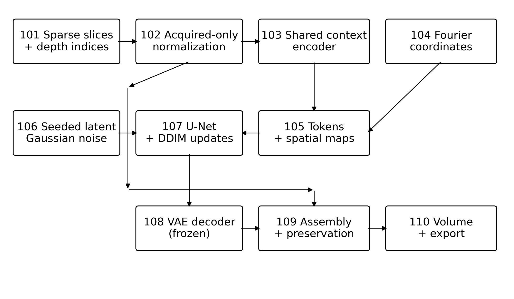

# Sparse-to-dense brain MRI reconstruction

Research software that estimates missing axial slices using conditional latent diffusion. Demonstrated scope: retrospective single-channel FLAIR brain MRI. Acquired slices remain exact in the normalized input space; generated anatomy can be incorrect.

Git tracks source code, configuration, tests, and compact experiment evidence. Academic Word/PDF documents, slide decks, presentation bundles, dataset metadata, datasets, checkpoints, local tool installations, document preview pages, intermediate exports, and generated volume arrays stay local through `.gitignore` and are shared separately. Document filenames mentioned below refer to local deliverables. Re-run the corresponding scripts to regenerate generated artifacts; for example, `scripts/review_experiment.py` produces `results/review/example_comparison.npz` for `scripts/verify_reconstruction.py`.

## Deliverables

- [Approved plan](PROJECT_REVIEW_PLAN.md), [review findings](results/review/REVIEW_FINDINGS.md), [experiment report](results/review/EXPERIMENT_REPORT.md)
- [Reference results](results/review/test_reference.csv), [selected results](results/review/test_selected.csv), [selection](results/review/selection.json), [paired comparisons](results/review/paired_comparison.csv)
- [Dataset audit](results/review/dataset_audit.json), [project inventory](results/review/project_inventory.json)
- Filled disclosure (local file: Invention_Disclosure_Filled.docx), [prior art](results/review/PRIOR_ART.md), [drawings](results/review/drawings), [inventor confirmation checklist](results/review/INVENTOR_CONFIRMATION.md)
- Final disclosure (local file: Invention_Disclosure_Final.docx), [finalization report](results/review/disclosure_final/FINALIZATION_REPORT.md), [verification](results/review/disclosure_final/verification.json), [source register](results/review/disclosure_final/sources.json). Finalized on 9 October 2026; all 18 native Word pages visually checked. Q25, diagram/caption placement, evidence tables and TRL layout corrected. Approved diagram images are unchanged. Unconfirmed inventor, ownership, chronology and provenance facts remain explicitly flagged.
- Preserved v2 disclosure (local file: Invention_Disclosure_Revised_v2.docx), [revision change log](results/review/disclosure_revision/REVISION_CHANGELOG.md), [pending confirmations](results/review/disclosure_revision/PENDING_CONFIRMATIONS.md), [expanded prior-art review](results/review/disclosure_revision/PRIOR_ART_REVISION.md).
- [Original README](results/review/original_README.md); original presentations, template, checkpoints, historical results and existing user edits are preserved

## Setup

Run commands from the project directory. Measured environment: Python 3.10.10, PyTorch 2.9.1+cu128, NVIDIA RTX 5060 Laptop GPU, approximately 8 GB VRAM. The interpreter requested for this review is:

```powershell
$projectPython = 'D:\Kaggle competetion\torch_env\Scripts\python.exe'
& $projectPython -m pytest tests -q
```

For another machine, create a Python 3.10+ environment, install a compatible PyTorch build using the [official installer](https://pytorch.org/get-started/locally/), then install project requirements:

```text
python -m venv .venv
# Activate .venv using your operating system's activation command.
python -m pip install -r requirements.txt
```

Visualization packages are optional for reconstruction but included for existing viewers. CPU operation is supported; its speed was not benchmarked. Rebuilding the disclosure also requires `requirements-documents.txt`; this review installed document libraries separately under `.review_tools/` using the approved interpreter.

## Data and trained checkpoints

Expected data: `BraTS2020_training_data/content/data/volume_<id>_slice_<z>.h5`, with `image` shaped H,W,4 and `mask` shaped H,W,3; metadata files include `meta_data.csv`, `name_mapping.csv` and `survival_info.csv`.

The local dataset contains 57,195 files: 369 complete volumes, each 155 planes at 240×240. Seed 42 yields 258 training / 55 validation / 56 test patients. These are internal partitions of the training collection. Fixed validation IDs: 2, 5, 9, 15, 28. Historical benchmark test IDs: 14, 21, 22, 35, 49, 50, 51, 53, 55, 59.

Code assumes channel order FLAIR/T1/T1ce/T2; the original converter provenance needs confirmation. Sampled mask channels are mutually exclusive, and their class mapping is unverified. They must not be assumed to represent overlapping WT/TC/ET regions. The [official BraTS description](https://www.med.upenn.edu/cbica/brats2020/data.html) describes source modalities and labels, but does not establish this HDF5 conversion's channel ordering or geometry.

Required original checkpoints:

| Checkpoint | Stored epoch | Validation objective |
|---|---:|---:|
| `experiments/checkpoints/vae/best_model.pt` | 13 | 0.0891816 |
| `experiments/checkpoints/diffusion/best_model.pt` | 48 | 0.1177198 |

These objectives are not reconstruction PSNR. Missing or incompatible weights fail explicitly. Original checkpoints remain intact; fine-tuning writes `experiments/review/finetune/latest.pt`. Manifests record SHA-256 identities. Supply data and trained artifacts separately when moving the project; there is no automatic download.

## Actual architecture



1. Calculate foreground 0.5th/99.5th percentile intensity bounds from **acquired slices only** and apply them consistently to context and withheld targets, mapping to [-1,1].
2. A custom shared residual convolutional encoder processes the bounding acquired slices. It is not a pretrained ResNet18.
3. Fourier embeddings encode `z/(D-1)`, relative offset `(z-z_prev)/(z_next-z_prev)` and gap `(z_next-z_prev)/16`. At 240×240, conditioning contains 17×256 tokens and 8×30×30 spatial maps.
4. A 2D U-Net (base 64, multipliers 1/2/4) predicts noise in four-channel 30×30 VAE latents using spatial concatenation and cross-attention. Default schedule: cosine, 1,000 training timesteps.
5. Seeded DDIM sampling and the frozen VAE decoder generate missing planes. Optional Gaussian depth smoothing uses sigma 0.5; acquired planes are restored exactly afterward.

The VAE uses base 32, multipliers 1/2/4/4, bottleneck attention and latent scale 0.18215. Its objective is L1 + 0.5×MSE + 1e-5×KL + 0.1×spatial-gradient L1. Compression is 8× per spatial axis and 16× in scalar elements for FLAIR. Fine-tuning minimizes noise MSE. No explicit 3D consistency loss or segmentation network is implemented.

The reconstruction API accepts D,C,H,W and actual acquired indices including both boundaries. Missing planes are their complement, supporting irregular spacing. Spatial dimensions must be divisible by 8 with compatible model shapes. Exact preservation refers to the API's input values; clipping/normalization does not preserve raw scanner intensities invertibly.

## Commands

Original script names are compatibility entry points for the corrected interfaces.

### Reconstruct

```powershell
& $projectPython scripts/reconstruct_volume.py --vol_id 14 --stride 8 --seed 42 --steps 25 --weights raw --output-dir results/review/my_reconstruction
& $projectPython scripts/reconstruct_volume.py --vol_id 14 --stride 16 --format h5 --no-smoothing --output-dir results/review/my_hdf5
```

Choose compatible weights with `--diffusion-ckpt` and `--vae-ckpt`. `--weights ema` requires stored EMA; original checkpoints average the U-Net only, new checkpoints also average the encoder. These commands simulate acquisition from dense local data and evaluate withheld slices. The Python API also accepts genuinely sparse normalized stacks without ground truth.

NIfTI axes: H,W,D for one channel, H,W,D,C for multiple channels. HDF5 retains D,C,H,W. JSON sidecars record normalized intensity, settings and provenance. When an affine is unavailable, qform/sform codes and spatial units are unknown; identity coordinates are voxel indices, not verified patient geometry. Four-channel exports are tested, but joint trained checkpoints are unavailable.

### Benchmark

```powershell
& $projectPython scripts/evaluate_all.py --vols 10 --strides 8 16 --output-dir results/review/my_benchmark
& $projectPython scripts/evaluate_all.py --vols 1 --strides 8 16 --no_diff --output-dir results/review/my_baselines
```

Baselines: nearest, linear, cubic, and `smoothed_linear` (linear interpolation plus Gaussian depth smoothing, sigma 0.7). `bspline_3d` and `BSpline3DVolumeInterpolator` remain compatibility aliases; they do not implement B-splines. PSNR uses data range 2. SSIM uses an 11×11 Gaussian window, sigma 1.5, with zero padding. Full-volume and missing-slice metrics include background; selection uses missing slices.

### Fine-tune and resume

```powershell
& $projectPython scripts/finetune_diffusion.py --init-checkpoint experiments/checkpoints/diffusion/best_model.pt --strides 4 8 16 --lr 2e-5 --seed 42 --time-limit-minutes 70 --max-steps 3000 --batch-size 8 --output-dir experiments/review/new_run
& $projectPython scripts/finetune_diffusion.py --resume experiments/review/new_run/latest.pt --strides 4 8 16 --seed 42 --max-steps 6000 --time-limit-minutes 30 --output-dir experiments/review/new_run
```

Initialization starts a fresh optimizer from trained weights. Explicit resume restores optimizer, AMP scaler, EMA and sampler/PyTorch/CUDA random states; its step target is cumulative and saved optimizer learning rate is retained. Keep data, seed, architecture, strides and batch size consistent across resume. A fresh run refuses an existing `latest.pt`.

Each stride has equal sampling probability with replacement; observed counts vary. Targets exclude acquired slices. VAE is frozen, augmentation disabled, AdamW weight decay 1e-4, clipping norm 1, EMA decay 0.999. Runs stop at the time or step cap and save every 500 steps and at exit.

`train_diffusion.py` now exposes bounded fine-tuning. Historical epoch/minimum-LR fields in the YAML do not control this interface. CLI controls LR, batch size, seed, strides, output and time/step limits; model dimensions, noise schedule, weight decay, clipping, AMP and EMA decay use configuration. Unsupported backbones, prediction types and conditioning/sampling modes fail clearly. `train_vae.py` retains separate VAE training and automatic resume; the improvement experiment did not retrain the VAE.

### Complete review protocol

```powershell
& $projectPython scripts/review_experiment.py
```

This fixed protocol writes `results/review/` and `experiments/review/finetune/`. Archive those new run directories or choose separate paths in the script before reproducing. The maximum budget is reference 20 minutes, fine-tuning 70 minutes (also capped at 3,000 steps), selection/final comparisons 30 minutes. Actual duration is reported.

Five fixed validation patients compare raw/EMA, 25/50 DDIM steps and smoothing off/on. Candidate selection requires higher mean missing-slice PSNR over strides 8/16 and non-decreasing SSIM against the best corrected reference validation setting. The final test comparison uses a common corrected raw 25-step smoothed reference. A non-qualifying candidate remains saved as experimental evidence while the reference stays selected.

### Verification and documents

```powershell
& $projectPython -m pytest tests -q
& $projectPython scripts/audit_project.py
& $projectPython scripts/build_disclosure.py
& $projectPython scripts/view_volume.py --file results/review/example_reconstruction.nii.gz --montage
```

The last command exports a static montage; omit `--montage` for an interactive viewer. It reads project axes explicitly and uses sidecar intensity statistics for comparable ground truth. Existing PyVista/Blender assets can use ground-truth masks and heuristic tissue categories; they are not evidence of generated tumor accuracy.

## Measured review results

<!-- REVIEW_RESULTS_START -->
Corrected original reference retained using raw weights, 25 DDIM steps, smoothing True.

| Stride | Method | Missing PSNR (dB), mean ± SD | Missing SSIM, mean ± SD | Mean seconds |
|---|---|---:|---:|---:|
| 8 | Corrected reference | 28.037 ± 1.577 | 0.9054 ± 0.0121 | 7.65 |
| 8 | Selected | 28.037 ± 1.577 | 0.9054 ± 0.0121 | 7.93 |
| 8 | Linear | 27.628 ± 1.119 | 0.9226 ± 0.0097 | 0.15 |
| 8 | Smoothed linear | 27.628 ± 1.119 | 0.9225 ± 0.0097 | 0.21 |
| 16 | Corrected reference | 25.071 ± 1.076 | 0.8818 ± 0.0119 | 7.29 |
| 16 | Selected | 25.071 ± 1.076 | 0.8818 ± 0.0119 | 8.40 |
| 16 | Linear | 24.550 ± 1.242 | 0.8752 ± 0.0123 | 0.15 |
| 16 | Smoothed linear | 24.550 ± 1.242 | 0.8752 ± 0.0123 | 0.20 |

Across 20 patient/stride pairs, selected versus the corrected raw 25-step smoothed reference: PSNR change +0.000 ± 0.000 dB; SSIM change +0.0000 ± 0.0000.

Total bounded protocol: 40.36 minutes (maximum 120). Fine-tuning: 3000 steps, 18.49 minutes, stopped by step_limit. See the experiment report for timing scope and limitations.
<!-- REVIEW_RESULTS_END -->

Historical CSVs are preserved and use different preprocessing. Earlier diffusion missing-slice PSNR means were 27.785 dB at stride 8 and 25.260 dB at stride 16; they cannot be pooled with corrected measurements.

## Limits and disclosure status

- Retrospective local FLAIR data; ten test patients and one training seed. No external validation. Background can inflate fidelity scores.
- The frozen VAE was trained with historical preprocessing; acquired-only calibration may create a residual intensity-distribution mismatch.
- No clinical efficacy, lesion-preservation study, calibrated uncertainty, scan-time/cost savings or segmentation Dice evidence.
- Generated anatomy can be wrong despite conditioning and deterministic sampling. Physical geometry and scanner measurement consistency are unavailable.
- CT, other organs, larger contexts and joint modalities are proposed embodiments requiring separate evidence.
- Relevant prior art includes [latent diffusion](https://arxiv.org/abs/2112.10752), [CaLID](https://arxiv.org/abs/2508.13826), [inter-slice consistent stochasticity](https://arxiv.org/abs/2602.04162), and [missing-slice patent claims](https://patents.google.com/patent/US11410271B2/en). Novelty is not established.
- The filled form contains supported technical detail and proposed claims. Inventor identity, ownership, funding and disclosure dates require inventor confirmation. Commercial companies are research leads with no established relationship. Provisional development stage: TRL 4.
- All 29 disclosure sections and the template table structure are checked. Word's background renderer failed to initialize, so final pagination needs visual inspection in Word. The drawings were inspected directly.
